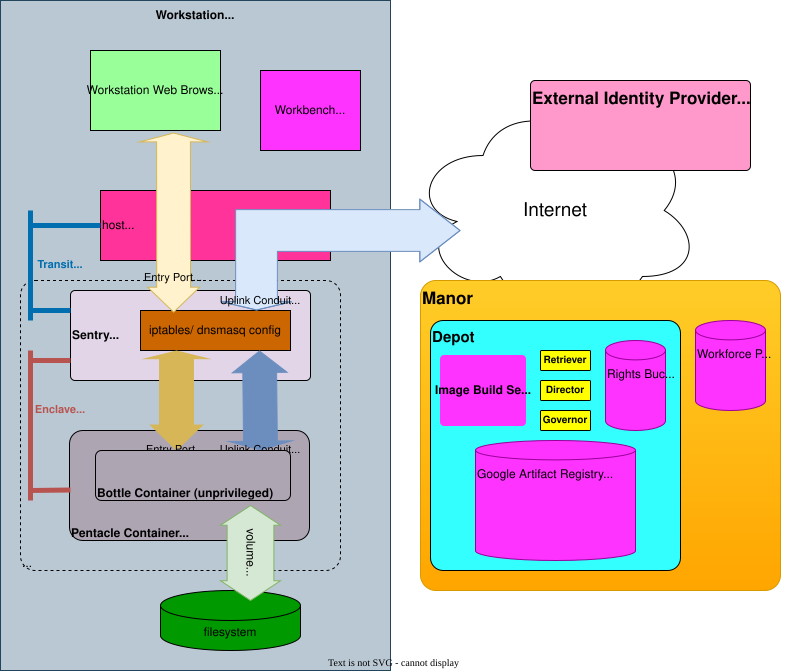

# <a id="RecipeBottle"></a>Recipe Bottle

Containers give you control over what runs.
Getting that control to hold at the *edges* — [knowing where an image actually came from](#ControlledContainerBuilds), and [constraining what it can reach once it runs](#RestrictingAccess) — is normally a standing job for a platform team.

[Recipe Bottle](#RecipeBottle) collapses that cost.
It's a set of bash scripts with a deliberately tiny dependency surface: running it needs only `bash 3.2`, `curl`, `openssl`, `jq`, and a handful of standard tools — no Python runtime, no language package manager, no `gcloud` CLI — so there is nothing language-specific to install and almost nothing of its own to audit, patch, or trust.
A small team can stand up a hardened build pipeline and a sandboxed runtime without one; after initial setup, every cloud API call is `openssl` + `curl`.

It extends a container's control to its two edges:

- **[Foundry](#Foundry)** — *where images come from.* Orchestrates Google Cloud Build to produce multiplatform images (x86 + ARM) with verifiable [SLSA provenance](#Provenance), serves them from a role-managed private cloud registry, and can build [egress-locked](#BuildIsolation) so a compromised build step cannot phone home.
- **[Crucible](#Crucible)** — *what images can reach.* Runs untrusted containers — even images pulled unmodified "in the wild" — behind enforced network isolation: DNS and IP filtering that a compromised workload cannot bypass.

The two compose, but neither requires the other.

> [!IMPORTANT]
> **Early-stage project — security review welcome in both domains.** The [Foundry's](#Foundry) egress-locked Cloud Build configuration — including the [SLSA](#Provenance) attestation chain, [build isolation](#BuildIsolation), and digest-pinned toolchains — has not yet had broad independent review.
> The [Crucible](#Crucible) runtime containment — a multi-container apparatus where the workload runs unprivileged in a network namespace it does not control — has also not had broad review, particularly the network isolation rules, privileged namespace setup, and egress enforcement.
> If you evaluate or deploy this, you are contributing to its hardening.
> Security-focused contributors and responsible disclosure are especially valued.

**Host platform scope.** [Recipe Bottle](#RecipeBottle) is release-qualified on Linux and macOS with Docker.
Windows host support works and is exercised in testing, but is not yet part of the release-qualification baseline — treat it as supported-experimental for now.

**Project page**: [scaleinv.github.io/recipebottle](https://scaleinv.github.io/recipebottle)

<p align="center"></p>

## Environment

### Supported Platforms

[Recipe Bottle's](#RecipeBottle) [Crucible](#Crucible) runtime is qualified for release against **Docker** as the container runtime, on two host families:

- **Linux host** — native Docker Engine (Docker CE / `docker.io`) running directly on the host kernel; no VM. Tested on Ubuntu LTS with cgroup v2 and a 6.x kernel.
- **macOS host** — Docker Desktop for Mac on a supported macOS release. Apple Silicon hosts use the Apple Virtualization framework or Docker VMM hypervisor backend.

Windows host support works — [Recipe Bottle](#RecipeBottle) runs on Windows via Docker Desktop — but is not yet part of the release-qualification baseline; treat it as supported-experimental pending a green Windows test pass.
Podman support is architecturally accommodated by the spec but deferred — see [Podman Support](#PodmanSupport).

One dependency note for evaluators: [Recipe Bottle's](#RecipeBottle) regression and adversarial test suites — including the [Theurge](#Theurge) orchestrator — are written in Rust.
Validating the [Crucible's](#Crucible) containment yourself, or contributing, additionally needs a Rust toolchain; running Recipe Bottle does not.

### Regimes and Tabtargets

All configuration flows through [Regimes](#Regime) — structured `.env` files with typed validation, each with its own render and validate commands.
Some regimes are committed in the repo: [Vessel](#Vessel) definitions ([RBRV](#RBRV)), [Nameplate](#Nameplate) configurations ([RBRN](#RBRN)), [Depot](#Depot) identity ([RBRD](#RBRD)), repository-wide settings ([RBRR](#RBRR)), [Payor](#Payor) identity ([RBRP](#RBRP)), the [Manor's](#Manor) workforce-pool record ([RBRW](#RBRW)), and [per-Foedus](#Foedus) federation trust ([RBRF](#RBRF)).
Others live on the filesystem outside revision control: [Payor](#Payor) OAuth credentials ([RBRO](#RBRO)) and developer workstation paths ([BURS](#BURS)).

Every operation is launched through a [Tabtarget](#Tabtarget) — a shell script in the `tt/` directory.
The critical property: tab completion finds the command you want.
Type `tt/rbw-<TAB>` and the shell narrows to all [Recipe Bottle](#RecipeBottle) operations; type `tt/rbw-f<TAB>` to see just the [Foundry](#Foundry) build and [Hallmark](#Hallmark) commands.
Each [Tabtarget](#Tabtarget) is named `{colophon}.{frontispiece}[.{imprint}].sh` — the colophon routes to the right module, the frontispiece tells you what it does, and an optional imprint names the target it acts on.

<a id="Log"></a>A [Tabtarget](#Tabtarget) that logs writes three [Log](#Log) files to the directory named by `BURS_LOG_DIR` in your [BURS](#BURS) station file: a stable-name file overwritten by every dispatch, a per-command file overwritten by the next run of the same command (tools like SlickEdit sense diffs between executions), and a timestamped historical file that is never overwritten, the one to read.
Disk space is cheap, so commands log by default and the diagnostic evidence is there when something fails; a command handling secrets, or one that runs before a station file stands, does not.
Handbooks don't [Log](#Log) — teaching output is ephemeral.

<a id="Transcript"></a>A [Transcript](#Transcript) is a single file capturing key decision points and state transitions within a [Tabtarget's](#Tabtarget) execution.
Where [Logs](#Log) preserve full terminal output, a [Transcript](#Transcript) records the structured progress of sophisticated orchestration commands — the first thing to read when debugging a multi-step failure.

<a id="Output"></a>The [Output](#Output) directory is a fixed-path staging area for each [Tabtarget](#Tabtarget) run: at the start of a dispatch the previous run's outputs move aside into a sibling `previous/` directory, so one prior run's artifacts survive.
Commands that produce artifacts write them here.
Concurrent bash sessions share this path, so parallel commands can overwrite each other's [Output](#Output).

To begin, run the onboarding walkthrough:

```
tt/rbw-o.ONBOARDING.sh
```

## Foundry

<a id="Foundry"></a>**Foundry**

Recipe Bottle's remote build orchestration system for producing, attesting, and distributing container images via Google Cloud Build and Google Artifact Registry.
The [Foundry](#Foundry) encompasses [RB Depots](#Depot), [Vessels](#Vessel), and [Hallmark](#Hallmark) tracking.
Three vessel modes determine how images enter the [Depot](#Depot): conjure (egress-locked build from source with SLSA provenance), bind (digest-pinned upstream mirror), and graft (local push).
Peer to [Crucible](#Crucible), which handles local runtime containment.

The [Foundry](#Foundry) orchestrates Google Cloud Build to produce container images with [SLSA](#Provenance) attestation, software bills of material, multi-architecture builds, and digest-pinned toolchains — so every image has a verifiable origin story.
Builds can run [egress-locked](#BuildIsolation), and every build draws its base images from copies captured into a project-owned [Depot](#Depot) registry — a fixed, self-contained supply chain independent of third-party registry availability.

### Depot

The facility where container images are built and stored — has its own GCP project with an artifact registry and two build worker pools, funded under the [Manor's](#Manor) billing account.
The [Payor](#Payor) [Levies](#Levy) a [Depot](#Depot), and the [Governor](#Governor) administers access to it.
Each [Depot](#Depot) operates as an independent supply-chain boundary with its own credentials, builds, and registry.

Each [Depot](#Depot) supports two build egress profiles:

- <a id="Tethered"></a>**[Tethered](#Tethered)** — Build egress mode allowing public internet access during Cloud Build, for build steps that fetch what they need from the internet. [Tethered](#Tethered) builds still take their base images from [Lodes](#Lode) in the [Depot's](#Depot) registry — simpler to write for, but dependent on the internet at build time.
- <a id="Airgap"></a>**[Airgap](#Airgap)** — Build egress mode with no public internet access during Cloud Build.
  [Airgap](#Airgap) builds draw everything from [Lodes](#Lode) in the [Depot's](#Depot) registry — fully self-contained, independent of upstream availability.
  See [Build Isolation](#BuildIsolation) for the security rationale behind these profiles.

### Manor

The [Payor's](#Payor) administrative seat — holds the billing account and the OAuth client.
[Depot](#Depot) projects are created and funded under the [Manor's](#Manor) authority.
The [Manor](#Manor) has its own GCP project, distinct from any [Depot](#Depot) project.
From the [Manor](#Manor) the [Payor](#Payor) [Instaurates](#Instaurate) the identity substrate — the one organization-level workforce pool that every [Depot's](#Depot) federated sign-in trusts — and [Affiances](#Affiance) each external identity provider as a [Foedus](#Foedus) beneath it; the [Manor](#Manor) also homes the [Terrier](#Terrier) that records which [Citizens](#Citizen) hold which [Mantles](#Mantle).

### Payor

[Establishes](#Establish) a [Manor](#Manor) and funds [Depot](#Depot) projects through it; authenticates via OAuth.
The [Payor](#Payor) is the only role requiring manual Google Cloud Console interaction — [Establishing](#Establish) the [Manor](#Manor), configuring OAuth, and [Installing](#Install) credentials via browser flow.
All other roles are [Mantles](#Mantle) worn by federated [Citizens](#Citizen): the [Payor](#Payor) founds the identity trust they sign in against and [Girds](#Gird) the first [Governor](#Governor).

### Governor

Administers a [Depot](#Depot): admits operators and manages access.
The [Governor](#Governor) is a [Mantle](#Mantle) — a federated [Citizen](#Citizen) wears it, [Girded](#Gird) by the [Payor](#Payor) as the [Depot's](#Depot) founding act or [Brevetted](#Brevet) by a standing governor thereafter.
The [Governor](#Governor) [Brevets](#Brevet) [Citizens](#Citizen) onto [Governor](#Governor), [Director](#Director) and [Retriever](#Retriever) [Mantles](#Mantle), [Unseats](#Unseat) a [Mantle](#Mantle) no longer needed, [Attaints](#Attaint) a [Citizen](#Citizen) entirely, and [Rehearses](#Rehearse) the [Terrier](#Terrier) roster.

### Director

Builds and publishes [Vessel](#Vessel) images into a [Depot](#Depot).
Each [Director](#Director) credential is scoped to one [Depot](#Depot).
The [Director](#Director) manages the image lifecycle: [Ordain](#Ordain) a [Hallmark](#Hallmark), [Vouch](#Vouch) the [provenance](#Provenance) of any still pending, [Rekon](#Rekon) a [Hallmark's](#Hallmark) registry presence, [Wrest](#Wrest) a specific image directly, [Abjure](#Abjure) superseded artifacts, and [Jettison](#Jettison) individual tags.

### Retriever

Pulls and runs [Vessel](#Vessel) images from a [Depot](#Depot).
This is the most constrained role — read-only access to the [Depot](#Depot) registry.
The [Retriever](#Retriever) [Summons](#Summon) images for local use, [Tallies](#Tally) [Hallmarks](#Hallmark) by health, and [Plumbs](#Plumb) their [provenance](#Provenance).

### Vessel

A specification for a container image — built from source ([Conjure](#Conjure)), mirrored from upstream ([Bind](#Bind)), or pushed from local ([Graft](#Graft)).
Each [Vessel](#Vessel) is a directory under `rbmm_moorings/rbmv_vessels/` containing at minimum an `rbrv.env` configuration file; [Conjure](#Conjure) [Vessels](#Vessel) also include a Dockerfile.
A [Conjure](#Conjure) [Vessel](#Vessel) can also be [Kludged](#Kludge) — built locally for development, its base images fetched beforehand — which is an operation rather than a fourth mode.

### Hallmark

A specific build instance of a [Vessel](#Vessel), identified by its build mode and build time.
Each [Hallmark](#Hallmark) stands in the [Depot](#Depot) registry as a set of artifacts — its [Ark](#Ark) — led by the container image (`image`), the [software bill of materials](#SBOM) ([`about`](#About)), and the provenance verification record ([`vouch`](#Vouch)); [Rekon](#Rekon) shows a [Hallmark's](#Hallmark) full [Ark](#Ark) census.
[Hallmark](#Hallmark) values are recorded into [Nameplate](#Nameplate) [Regime](#Regime) files to pin a [Nameplate](#Nameplate) to specific image versions.

### Foundry Lifecycle

[Recipe Bottle](#RecipeBottle) uses a role-based security model with four operator roles:

| Role | Authenticates via | Purpose |
| --- | --- | --- |
| **[Payor](#Payor)** | OAuth (browser flow) | Creates and funds GCP infrastructure, founds the [Manor](#Manor), [Girds](#Gird) the first [Governor](#Governor) |
| **[Governor](#Governor)** | Federated sign-in → [Governor](#Governor) [Mantle](#Mantle) | Admits [Citizens](#Citizen) to the mantles of a [Depot](#Depot) |
| **[Director](#Director)** | Federated sign-in → [Director](#Director) [Mantle](#Mantle) | Submits builds, manages images, verifies [provenance](#Provenance) |
| **[Retriever](#Retriever)** | Federated sign-in → [Retriever](#Retriever) [Mantle](#Mantle) | Pulls images for local use |

The [Payor](#Payor) stands apart — it authenticates with its own OAuth refresh token, the system's sole durable secret.
Every other role is a [Mantle](#Mantle): a standing office a federated operator [Avows](#Avow) into to open a [Sederunt](#Sederunt), then [Dons](#Don) for the work at hand.
**Zero service-account keys exist anywhere in the system.**

This model **requires a GCP organization and an external OIDC identity provider** — the founding cost of corporate-acceptable identity, and the one prerequisite federation does not waive.
A qualifying organization is free via Google Cloud Identity once you verify ownership of a **DNS domain**, and a conformant IdP tenant (Microsoft Entra, Keycloak, Okta, …) provisions in minutes — so the real prerequisite is controlling a domain, not paying Google.
That one-time founding hour buys short-lived sign-in, central revocation at the identity provider, and no static secret at rest.

#### Establishment and Provisioning

The [Payor](#Payor) begins by [Establishing](#Establish) a GCP project and OAuth consent screen through the Google Cloud Console, then [Installs](#Install) the downloaded client credentials via a browser authorization flow.

With [Payor](#Payor) credentials in place, the [Payor](#Payor) [Instaurates](#Instaurate) the [Manor's](#Manor) identity substrate, [Affiances](#Affiance) an external identity provider as a [Foedus](#Foedus), then [Levies](#Levy) a [Depot](#Depot) and raises its three [Mantle](#Mantle) service accounts.
The [Payor's](#Payor) last founding act is to [Gird](#Gird) the first [Governor](#Governor), seating a federated [Citizen](#Citizen) in the governor mantle.

Before the first build can run, the [Depot](#Depot) needs its supply-chain infrastructure in place: upstream base images and the cohort of builder tool images must be [Captured](#Capture) into the registry as [Lodes](#Lode).

#### Admission and Access

A standing [Governor](#Governor) populates the [Depot](#Depot): it [Brevets](#Brevet) a [Citizen](#Citizen) onto a [Director](#Director) mantle for build work and onto a [Retriever](#Retriever) mantle for image pulls, and [Unseats](#Unseat) a mantle no longer needed — each admission recorded as a [Muniment](#Muniment) in the [Manor's](#Manor) [Terrier](#Terrier).
At runtime the [Citizen](#Citizen) [Avows](#Avow) to open a [Sederunt](#Sederunt), then [Dons](#Don) whichever mantle the operation calls for.

#### Build and Retrieve

The [Director](#Director) [Ordains](#Ordain) [Hallmarks](#Hallmark) for each [Vessel](#Vessel) — [Conjuring](#Conjure) from source, [Binding](#Bind) from upstream, or [Grafting](#Graft) from local builds.
Each [Ordain](#Ordain) chains its own metadata and [Vouch](#Vouch) stages, and the [Director](#Director) can [Vouch](#Vouch) any [Hallmark](#Hallmark) still pending in one batch; the [Retriever](#Retriever) [Tallies](#Tally) [Hallmarks](#Hallmark) by health status.

Build results become durable by being written into committed [Regime](#Regime) lines: each chain-link verb — [Yoke](#Yoke), [Feoff](#Feoff), [Anoint](#Anoint), [Mitre](#Mitre) — resolves a fresh build fact into the configuration lines it owns, which the operator then commits.
The chain is what lets every later build and every [Charge](#Charge) draw on a pinned, reviewable record instead of a floating reference, a [Hallmark](#Hallmark) being [Mitred](#Mitre) into its [Nameplate's](#Nameplate) [Regime](#Regime) file to complete the chain from build to runtime.

The [Retriever](#Retriever) [Summons](#Summon) a [Hallmark's](#Hallmark) images locally for use.

[Recipe Bottle](#RecipeBottle) builds container images on Google Cloud Build (GCB) and stores them in Google Artifact Registry (GAR):

- Isolated build environments on Cloud Build, every builder tool image drawn from a captured [Reliquary](#Reliquary)
- Multi-architecture support via `docker buildx` with binfmt emulation
- [SLSA provenance](#Provenance) attestation and verification
- [Software Bills of Material (SBOM)](#SBOM) for every build
- Build metadata — the [SBOM](#SBOM), the build info and the build recipe — kept in an [About](#About) artifact beside the image
- Upstream base images [Captured](#Capture) into the [Depot's](#Depot) registry as [Lodes](#Lode), so builds do not depend on third-party registry availability at build time
- `gcloud` never runs on the workstation — REST calls via `curl` and `jq` drive all remote operations, and the Google-supplied `gcloud` binary is confined to Cloud Build step containers on the server side

Each build's source context is packaged as a [Pouch](#Pouch) — the security boundary between workstation and build infrastructure.

## Crucible

The distinctive case [Recipe Bottle](#RecipeBottle) addresses is *running untrusted code*: third-party tooling, experimental packages, binaries with uncertain [provenance](#Provenance).
Containers excel at packaging known applications, but running unvetted code poses security risks that ordinary container deployment does not solve.
[Recipe Bottle](#RecipeBottle) assembles a [Crucible](#Crucible) — three cooperating containers where a [Sentry](#Sentry) enforces network policy — without requiring modifications to existing container images.
The [Bottle](#Bottle) container runs unmodified, in a network namespace prepared by a privileged [Pentacle](#Pentacle), with all egress flowing through the [Sentry](#Sentry) gateway.

The [Sentry](#Sentry), [Pentacle](#Pentacle) and [Bottle](#Bottle) run together as one unit defined by a [Nameplate](#Nameplate).
The [Crucible](#Crucible) is the local safety orchestration — the apparatus that makes running untrusted code practical.
[Charging](#Charge) starts all three containers; [Quenching](#Quench) stops and cleans them up.

### Nameplate

[Per-Crucible](#Crucible) configuration tying a [Sentry](#Sentry) and [Bottle](#Bottle) together into a runnable unit.
The [Nameplate](#Nameplate) moniker (e.g. `tadmor`) identifies the unit across all operations.
Each [Nameplate](#Nameplate) declares its [Vessel](#Vessel) selections, [Hallmark](#Hallmark) pins, and the network policy that the [Sentry](#Sentry) enforces.

### Containers

- **[Sentry](#Sentry)** — Security container enforcing network policies via `iptables` and `dnsmasq`.
  The [Sentry](#Sentry) applies two layers of egress policy: DNS-level filtering (only allowed domain names resolve) and IP-level filtering (only allowed CIDR ranges pass).
  A compromised [Bottle](#Bottle) cannot bypass either layer — the [Sentry](#Sentry) is the sole gateway between the [Bottle](#Bottle) and the outside network.
- **[Pentacle](#Pentacle)** — Privileged container establishing the network namespace shared with the [Bottle](#Bottle).
  The [Pentacle](#Pentacle) runs privileged to create the network topology and remains as the namespace anchor.
  Security policies are enforced from the first packet because the [Sentry's](#Sentry) rules are already live when the [Pentacle](#Pentacle) prepares the namespace the [Bottle](#Bottle) will share.
- **[Bottle](#Bottle)** — Your workload container, running unmodified in a controlled network environment.
  The [Bottle](#Bottle) has no direct network access — all traffic routes through the [Sentry](#Sentry) gateway in a namespace prepared by the [Pentacle](#Pentacle).
  Any existing container image can run as a [Bottle](#Bottle) without modification.

### Enclave

The isolated network connecting a [Bottle](#Bottle) to its [Sentry](#Sentry) — the [Bottle's](#Bottle) only path to the outside world.
All [Bottle](#Bottle) traffic routes through the [Enclave](#Enclave) to the [Sentry](#Sentry) gateway; the [Bottle](#Bottle) has no interface on any other network.
The [Sentry](#Sentry) alone also stands on the [Transit](#Transit) network — the uplink that reaches the workstation and the world beyond — so the [Sentry](#Sentry) is the only container straddling both networks, and everything that leaves the [Enclave](#Enclave) crosses its policy.

### Crucible Lifecycle

[Charge](#Charge) the [Crucible](#Crucible) for a [Nameplate](#Nameplate) to start the [Sentry](#Sentry), [Pentacle](#Pentacle), and [Bottle](#Bottle) together — once the [Charge](#Charge) returns, the [Bottle](#Bottle) is ready for interactive use.
[Rack](#Rack) the [Bottle](#Bottle) to shell in, [Hail](#Hail) the [Sentry](#Sentry) to inspect the gateway, or [Scry](#Scry) the network to observe traffic across [Crucible](#Crucible) containers.
When finished, [Quench](#Quench) the [Crucible](#Crucible) to stop and clean up all three containers.
To inspect an image's supply chain, [Plumb](#Plumb) its [provenance](#Provenance) — the full view shows the [SBOM](#SBOM), build info, and Dockerfile; the compact view summarizes its trust posture.

### Reference Nameplates

Shipped [Nameplates](#Nameplate) demonstrating different [Crucible](#Crucible) configurations.
Each pairs a [Sentry](#Sentry) with a [Bottle](#Bottle) [Vessel](#Vessel) and defines the network policy for that deployment target.

<a id="ccyolo"></a>**ccyolo**

The Claude Code sandbox [Nameplate](#Nameplate), for network-contained AI development.
It pairs the [Sentry](#Sentry) with a Claude Code [Bottle](#Bottle) under an allowlist admitting Anthropic's service: SSH entry from the workstation, OAuth sign-in by copy and paste, everything else blocked.
Its images are built locally and never in the cloud, so it needs no cloud account, [Manor](#Manor) or [Depot](#Depot), and the onboarding's first hands-on track teaches the [Crucible](#Crucible) lifecycle with it.

<a id="tadmor"></a>**tadmor**

The adversarial testing [Nameplate](#Nameplate) for daily iteration.
It pairs the [Sentry](#Sentry) with the [Ifrit](#Ifrit) attack [Vessel](#Vessel) under a restrictive allowlist, consuming locally built [Hallmarks](#Hallmark) for fast author-test-iterate cycles.
The [Theurge](#Theurge) [Charges](#Charge) it and dispatches curated escape attempts, validating that the containment holds under adversarial conditions.

<a id="moriah"></a>**moriah**

The adversarial testing [Nameplate](#Nameplate) for the airgap supply chain.
It pairs the [Sentry](#Sentry) with the [Ifrit](#Ifrit) attack [Vessel](#Vessel) under the same restrictive allowlist as [tadmor](#tadmor), its [Bottle](#Bottle) built end to end on the airgap pool.
The [Theurge](#Theurge) runs the same escape attempts against it as against [tadmor](#tadmor), validating that containment holds identically when the supply chain produces the inputs.

<a id="srjcl"></a>**srjcl**

A Jupyter notebook server for network-contained analysis.
It pairs the [Sentry](#Sentry) with a conjure-mode Jupyter [Bottle](#Bottle) under an allowlist admitting Anthropic's API, a working service rather than an attack [Vessel](#Vessel), showing the [Crucible](#Crucible) running useful software with its egress fenced to a curated destination.

<a id="pluml"></a>**pluml**

A PlantUML diagram server that needs no outbound network.
It pairs the [Sentry](#Sentry) with a bind-mode PlantUML [Bottle](#Bottle), an upstream image pinned by digest, its egress disabled: the renderer needs no internet, so the [Crucible](#Crucible) grants it none.
It exercises the bind supply-chain path and the most restrictive network posture.

<a id="nineveh"></a>**nineveh**

A Kroki diagram render server, for Graphviz, PlantUML and D2, that needs no outbound network.
It pairs the [Sentry](#Sentry) with a bind-mode Kroki [Bottle](#Bottle) under the same disabled egress as [pluml](#pluml), with workstation entry published to the render port, a second working service showing the pattern generalizes.

<a id="fdkyclk"></a>**fdkyclk**

The Keycloak synthetic-federation test identity provider.
It pairs the [Sentry](#Sentry) with a conjure-mode Keycloak [Bottle](#Bottle) that mints programmatic OIDC tokens, the self-contained identity provider the federation test-bed [Charges](#Charge) to prove federated sign-in end to end without a corporate identity tenant.
It has no outbound network, and its entry is from the workstation only.

It is a synthetic test identity provider and no security boundary.
Its asserter signing key and client secret are committed in the repository by design, so the federation-admission path is proven deterministically with no human and no corporate tenant.
It is safe only as an isolated local test-bed: no production federation may trust its issuer, reuse its committed key, secret or realm, or drop its `fdkyclk-test-` subject namespacing, since anyone holding the repository can forge its assertions.

## <a id="HowThisIsNormallyDone"></a>Appendix: How This Is Normally Done

The two controls [Recipe Bottle](#RecipeBottle) provides are not novel — they are what a platform team normally assembles from dedicated infrastructure.
This appendix names that conventional stack, so the comparison stays honest and the trade-off stays legible.

### <a id="ControlledContainerBuilds"></a>Controlled container builds

Knowing where an image came from — and proving it — is the domain of software supply-chain security.
The stabilized toolchain pairs build provenance ([SLSA](https://slsa.dev)) with cryptographic signing ([Sigstore](https://www.sigstore.dev)/cosign), a [software bill of materials](#SBOM) ([Syft](https://github.com/anchore/syft)), vulnerability scanning, and deploy-time admission control ([Kyverno](https://kyverno.io), OPA Gatekeeper) that rejects unsigned or unattested images.
Reaching SLSA Build Level 2 with this stack is a matter of weeks; the [Foundry](#Foundry) reaches **Level 3** with none of it resident on the workstation.

### <a id="RestrictingAccess"></a>Restricting access

Constraining what a workload can reach on the internet is the domain of network egress control.
At the corporate-network tier this is a [secure web gateway](https://www.paloaltonetworks.com/cyberpedia/what-is-secure-web-gateway), increasingly bundled into [SASE](https://www.checkpoint.com/cyber-hub/network-security/what-is-secure-access-service-edge-sase/) alongside a CASB and firewall.
At the container tier it is [Kubernetes NetworkPolicy](https://kubernetes.io/docs/concepts/services-networking/network-policies/), usually upgraded to [Cilium](https://cilium.io/use-cases/egress-gateway/) or Calico for DNS-aware, deny-by-default egress.
That "deny-by-default, allow only where needed" posture is exactly the [Sentry](#Sentry) model.

**Honest scope.** These are multi-tenant corporate systems, centrally administered and kept alive by a standing team.
[Recipe Bottle](#RecipeBottle) puts the same two controls in reach of a small team or a solo developer; it is not a fleet-scale replacement for a secure web gateway or a service mesh, and does not try to be.
The value is the control, at a cost a small team can carry.

## Appendix: Adversarial Test Method

The [Crucible's](#Crucible) containment is validated through coordinated escape testing using two components:

- **[Ifrit](#Ifrit)** — Adversarial attack [Vessel](#Vessel) purpose-built to run inside a [Bottle](#Bottle), seeking escape.
  The [Ifrit](#Ifrit) carries its own Rust attack binary for raw packet construction, strace (syscall boundary probing), and a minimal footprint — tools chosen to probe every surface the [Sentry's](#Sentry) containment exposes.
  Named for the djinn imprisoned in a bottle.
- **[Theurge](#Theurge)** — Test orchestrator running on the host, outside the [Crucible](#Crucible).
  The [Theurge](#Theurge) [Charges](#Charge) a [Crucible](#Crucible) with the [Ifrit](#Ifrit) as its [Bottle](#Bottle), then dispatches curated, reproducible, version-controlled attack scripts targeting specific surfaces: DNS exfiltration, ICMP covert channels, cloud metadata probing, namespace breakout, and direct IP bypass attempts.
  Each attack runs inside the [Bottle](#Bottle) while the [Theurge](#Theurge) simultaneously observes the [Sentry's](#Sentry) network from outside — confirming that blocked traffic is actually blocked, not merely unrequested.

A [Sortie](#Sortie) is one named escape attempt in the [Ifrit's](#Ifrit) repertoire: a single attack vector, carried through end to end, returning its own verdict on whether the [Sentry's](#Sentry) containment held.
[Sorties](#Sortie) are deliberately self-contained and reproducible — one vector apiece, so a verdict names exactly which surface was tried — and run either as the full suite the [Theurge](#Theurge) dispatches, or singly against a [Crucible](#Crucible) already [Charged](#Charge) when one surface is under investigation.

The escape tests were developed through adversarial Claude Code sessions with full visibility into the [Sentry's](#Sentry) source, configuration, and the [Recipe Bottle](#RecipeBottle) specification.
The [Ifrit](#Ifrit) [Vessel](#Vessel) is the delivery vehicle; the intelligence came from the authoring process.
Every test that passes is evidence the containment holds — not proof.
The test suite grows as new attack surfaces are identified.

## <a id="Provenance"></a>Appendix: Supply Chain Provenance

Supply chain provenance is a cryptographically signed record of how a container image was produced — what source, what builder, what steps — so that consumers can verify an image came from trusted infrastructure and was not tampered with in transit or at rest.

[Recipe Bottle](#RecipeBottle) achieves [SLSA](https://slsa.dev) v1.0 Build Level 3 for [Conjure](#Conjure) builds, auto-generated by Google Cloud Build.
The [Vouch](#Vouch) step independently verifies each build's DSSE envelope signature against Google's attestor public keys from `projects/verified-builder` KMS — using Python standard library and `openssl` only, with no third-party verifier.

Provenance guarantees are mode-aware:

| [Vessel](#Vessel) Mode | Trust Basis | [Vouch](#Vouch) Verdict |
| --- | --- | --- |
| **[Conjure](#Conjure)** | Full SLSA v1.0 Level 3 — signed build provenance from GCB | DSSE envelope signature verification |
| **[Bind](#Bind)** | Digest-pin comparison — image in GAR matches pinned upstream reference | Digest-pin match |
| **[Graft](#Graft)** | Locally built and pushed — no Cloud Build for the image push | GRAFTED (explicit no-provenance marker) |

Deliberately excluded: no `slsa-verifier` binary, no `gcloud` CLI on the workstation, no `jq` in the verification path.
The [Vouch](#Vouch) verifier reconstructs Pre-Authenticated Encoding (PAE), decodes the base64url payload and signature, and verifies via `openssl dgst` against embedded attestor keys — a minimal, auditable trust chain.

## <a id="SBOM"></a>Appendix: Software Bill of Materials

A Software Bill of Materials ([SBOM](#SBOM)) is a machine-readable inventory of every component inside a container image — every OS package, every library, every binary, with versions.
Without one, a container image is an opaque filesystem whose contents you discover by running it, which is exactly the wrong time to find out it ships a vulnerable dependency.

[Recipe Bottle](#RecipeBottle) generates an [SBOM](#SBOM) for every build using [Syft](https://github.com/anchore/syft), scanning each per-platform image during the [About](#About) assembly step.
Each architecture gets its own [SBOM](#SBOM), kept with the build info and the build recipe in the [Hallmark's](#Hallmark) [About](#About) artifact in GAR.

An [SBOM](#SBOM) enables three hygiene practices that opaque images cannot support:

- **CVE triage before deployment** — when a vulnerability is announced, search your [SBOMs](#SBOM) rather than scanning running containers
- **Pre-deployment audit** — know what you are granting network access to before a [Crucible](#Crucible) is [Charged](#Charge)
- **Build-over-build drift detection** — compare [SBOMs](#SBOM) across [Hallmarks](#Hallmark) to see what changed between builds

The [Plumb](#Plumb) command surfaces [SBOM](#SBOM) contents: the full view shows package inventories; the compact view gives a trust-posture summary.

## <a id="BuildIsolation"></a>Appendix: Build Isolation

[Recipe Bottle](#RecipeBottle) supports two build egress profiles — [Tethered](#Tethered) and [Airgap](#Airgap) — that determine whether a Cloud Build job can reach the public internet.
The distinction is not primarily about availability; it is a security boundary that controls what can enter and exit the build environment.

**What [Airgap](#Airgap) protects: exfiltration and supply chain injection.** If a compromised dependency, build plugin, or Dockerfile instruction executes during your build, an [Airgapped](#Airgap) build cannot phone home — it cannot transmit source code, secrets, or intermediate artifacts to an external endpoint, and it cannot silently fetch malicious payloads.
This is defense-in-depth for proprietary code: even if a build step is compromised, the network is not available as an exfiltration channel.

**The curated gate principle.** [Airgap](#Airgap) does not mean "nothing external." It means all external content enters through a single auditable gate — [Lode](#Lode) [Capture](#Capture) — rather than ad-hoc network fetches during build.
The attack surface collapses from "any URL a Dockerfile mentions" to "the specific digests the [Director](#Director) [Captured](#Capture)."
Builder tool images enter through the same gate: [Captured](#Capture) as a co-versioned [Lode](#Lode) and pinned by digest for all subsequent builds.

**What [Airgap](#Airgap) does not protect: the base image contents.** Base images like `debian-slim` were themselves built with full internet access — `apt-get install` already ran inside them.
The [Airgap](#Airgap) protects *your* build steps on top of those bases, not the base image contents themselves.
Base images are vetted separately: digest-pinned at [Capture](#Capture) time and held as [Lodes](#Lode) in the [Depot's](#Depot) registry.
A [Tethered](#Tethered) build of the base image followed by an [Airgapped](#Airgap) build of your application is the expected pattern — the base image is a known input, your proprietary layers are the protected output.

**Regulatory alignment.** No framework mandates build-time network blocking by name, but egress-locked builds are the simplest way to evidence several common controls: FedRAMP CM-7 (least functionality) and SC-7 (boundary protection), SOC 2 CC6.1 (logical access) and CC8.1 (change management), and SLSA Level 3's hermetic build requirement.

## <a id="EventualConsistency"></a>Appendix: Eventual Consistency and the Missing Completion Contract

[Recipe Bottle](#RecipeBottle) is built on cloud APIs, and cloud APIs are *eventually consistent*: when you mutate state — grant a role, delete a [service account](#Mantle), link billing — the change does not take effect everywhere at once.
It propagates across replicas over seconds, occasionally minutes.
For systems that are read on essentially every API call across the globe, choosing fast, always-available reads over instantly-consistent ones is a defensible engineering tradeoff, and we grant it without complaint.

The defensible part is the consistency *model*.
The indefensible part is what the term quietly omits: a **completion contract**.
When a mutating call returns, it tells you nothing about whether the work is finished — there is no terminal-state signal you can poll to learn that the change has settled.
This is not a law of physics.
The pattern for providing it is well understood and widely shipped: Google's own API design guidelines define long-running operations with a `done` flag and a terminal state, and Azure's Resource Manager specifies an async-operation contract end to end.
The giants deliver it excellently in places — and then withhold it on exactly the operations that race: IAM propagation, billing linkage, identity lifecycle.
The capability exists; it is selectively absent where it would matter most.

Without a completion contract, every consumer independently reinvents the same retry-poll-tolerate scaffolding to compensate.
The honest version of that scaffolding polls for an *observable terminal state*; the dishonest version, which the gap quietly encourages, is a blind `sleep N` — a guessed magic number standing in for a signal that should have existed.
[Recipe Bottle](#RecipeBottle) holds the honest line where it can: it polls for the real state, requires *consecutive* confirming reads before believing a transition (debouncing the flap rather than trusting the first answer), and bounds every wait with a timeout so a never-settling operation fails loudly instead of hanging.

The sharpest instance is service-account deletion.
The delete returns an empty success with no operation handle, and the account is not actually removed — it is *soft-deleted*, recoverable for thirty days.
So even the simplest question, "is it gone; can I reuse the name?", has no clean answer: a read of the just-deleted account flaps between "present" and "absent" across replicas while the tombstone propagates, and no API will tell you when the name is safe to reuse.
[Recipe Bottle](#RecipeBottle) copes by treating a deleted service account as durably gone only after several consecutive "not found" reads — see the ["already exists" after a delete](#StaleDeleteRead) diagnostic for the symptom this produces.

Plainly: this is not a hard distributed-systems problem.
It is a completion contract the vendors chose not to provide, dressed in distributed-systems vocabulary.
"Eventual consistency" accurately describes the read path; here it is also a polite way of saying *we will not tell you when we are finished*.
We depend on Google Cloud and expect to keep depending on it — and building atop eventually-consistent APIs with no completion contract is still crappy engineering on the vendor's part, on exactly the surfaces where getting it right would cost them nothing in their consistency model.

## <a id="DisappearingUpstream"></a>Appendix: Registry Churn and Disappearing Upstream Images

The [Foundry](#Foundry) builds on images pulled from upstream registries.
Most are durable — an image pinned by digest stays fetchable, and a published checksum lets you re-verify the bytes later.
Some are not.
The sharpest case we have hit is Quay's `quay.io/podman/machine-os` family, the disk images a `podman machine` boots: Quay churns them rapidly — new images every few hours, retention measured in days — so a reference that resolved this morning can be gone by tomorrow.
For Quay's own use that is fine, and we grant it; for anyone who needs a *reproducible* build it is a trap.
The indefensible part is not the churn but what comes with it: no durable reference.
Quay retains no digest you can pin and publishes no checksum to verify against later, so a pinned build does not fail loudly when its base ages out — it breaks asynchronously, downstream, on someone else's clock.
That is not hypothetical; it is the failure that motivated this work.

The response is the **[Lode](#Lode)** — a project-owned copy captured once into the [Depot's](#Depot) own registry, so the bytes a build depends on cannot be pulled out from under it.
Recipe Bottle grades its confidence honestly rather than uniformly: where the upstream is durable a [Lode](#Lode) is *verified-against-published*, its bytes still re-checkable against the source; where it is not — as with the podman machine-os images — the [Lode](#Lode) carries the weaker but honest grade *recorded-at-acquisition*, attesting the exact digest captured and claiming nothing beyond it, because the upstream permits nothing beyond it.
A registry that ships images with no durable reference has decided reproducibility is not its concern; holding our own copy, and grading our confidence in it honestly, is the only sound way to build on an upstream that will not hold still.

## <a id="Roadmap"></a>Appendix: Roadmap

The following features are not yet implemented but are under consideration:

- <a id="CrucibleConduit"></a>**[Crucible Conduit for Cloud Services](#CrucibleConduit)** - An encrypted tunnel, its local end a dedicated vessel rather than the [Sentry](#Sentry), that lets [Bottles](#Bottle) reach cloud AI services (AWS Bedrock, Vertex AI, Azure OpenAI) without listing floating cloud IP ranges in the CIDR allowlist.
- <a id="BottleCredentialCustody"></a>**[Bottle Credential Custody](#BottleCredentialCustody)** - Move the service secrets a [Bottle](#Bottle) workload uses (cloud API keys, IAM keys, SSH keys) off the operator's workstation and into the [Bottle](#Bottle) itself, so a compromised workstation — holding only permission to [Charge](#Charge) — cannot leak them.
- <a id="VpcServiceControls"></a>**[VPC Service Controls](#VpcServiceControls)** - Google Cloud security perimeters that prevent data from being copied out of a project even if an attacker holds valid credentials.
- <a id="CosignSigning"></a>**[Cosign Container Signing](#CosignSigning)** - Cryptographic image signatures independent of registry trust.
- <a id="CdnAwareIpGating"></a>**[CDN-Aware IP Gating](#CdnAwareIpGating)** - Precise IP-level gating for allowed domains served by shared CDN address ranges (e.g. Cloudflare), where the [Sentry's](#Sentry) CIDR allowlist is necessarily coarse.
- <a id="PodmanSupport"></a>**[Podman Support](#PodmanSupport)** - Podman as an alternative container runtime to Docker.
- <a id="CrucibleToCrucible"></a>**[Crucible-to-Crucible Networking](#CrucibleToCrucible)** - A direct network path between the [Bottles](#Bottle) of different Crucibles, which today cannot reach each other's published entry ports.

## Appendix: Reference Project

This repository is the reference implementation of [Recipe Bottle](#RecipeBottle).
The annotated tree below maps its files to the concepts defined above.

| Path | Description |
| --- | --- |
| `Project Root/` |  |
| `├── CLAUDE.md` | [Claude Code](https://claude.com/claude-code) context for sessions working in this tree |
| `├── tt/` | [Tabtargets](#Tabtarget) — `tt/rbw-<TAB>` for all operations |
| `├── Tools/` |  |
| `│   ├── buk/` | Bash Utility Kit — portable CLI infrastructure |
| `│   └── rbk/` | Recipe Bottle Kit — domain logic |
| `└── rbmm_moorings/` | Consumer config root — [BURC](#BURC) + Recipe Bottle [Regimes](#Regime) + [Vessels](#Vessel) |
| `    ├── burc.env` | [BURC](#BURC) — project structure (tabtarget, tools, temp/output dirs) |
| `    ├── rbrp.env` | [RBRP](#RBRP) — [Manor](#Manor) identity: billing account, OAuth client, [Payor](#Payor) email |
| `    ├── rbrr.env` | [RBRR](#RBRR) — Repository-wide configuration shared across all operations |
| `    ├── rbrd.env` | [RBRD](#RBRD) — [Depot](#Depot) identity (frozen at [Levy](#Levy)) |
| `    ├── rbrw.env` | [RBRW](#RBRW) — [Manor](#Manor) workforce-pool record |
| `    ├── rbmf_foedera/` | [Foedus](#Foedus) library — one trust per subdirectory |
| `    │   ├── rbef_entrada/` | [RBRF](#RBRF) — Microsoft Entra [Foedus](#Foedus) |
| `    │   └── rbef_keycloak/` | [RBRF](#RBRF) — [fdkyclk](#fdkyclk) synthetic-test [Foedus](#Foedus) |
| `    ├── rben_ccyolo/` | [Nameplate](#Nameplate) — [ccyolo](#ccyolo) Claude Code sandbox |
| `    │   └── rbrn.env` | [RBRN](#RBRN) — [Sentry](#Sentry) + Claude Code, Anthropic allowlist |
| `    ├── rben_tadmor/` | [Nameplate](#Nameplate) — [tadmor](#tadmor) adversarial testing |
| `    │   └── rbrn.env` | [RBRN](#RBRN) — [Sentry](#Sentry) + [Ifrit](#Ifrit), restrictive allowlist |
| `    ├── rben_moriah/` | [Nameplate](#Nameplate) — [moriah](#moriah) airgap-built adversarial testing |
| `    │   └── rbrn.env` | [RBRN](#RBRN) — [Sentry](#Sentry) + [Ifrit](#Ifrit), restrictive allowlist |
| `    ├── rben_srjcl/` | [Nameplate](#Nameplate) — Jupyter notebook |
| `    │   └── rbrn.env` | [RBRN](#RBRN) — [Sentry](#Sentry) + Jupyter, Anthropic API allowlist |
| `    ├── rben_pluml/` | [Nameplate](#Nameplate) — PlantUML diagram server |
| `    │   └── rbrn.env` | [RBRN](#RBRN) — [Sentry](#Sentry) + PlantUML, no-egress allowlist |
| `    ├── rben_nineveh/` | [Nameplate](#Nameplate) — [nineveh](#nineveh) Kroki render server |
| `    │   └── rbrn.env` | [RBRN](#RBRN) — [Sentry](#Sentry) + Kroki, no-egress allowlist |
| `    ├── rben_fdkyclk/` | [Nameplate](#Nameplate) — [fdkyclk](#fdkyclk) Keycloak test IdP |
| `    │   └── rbrn.env` | [RBRN](#RBRN) — [Sentry](#Sentry) + Keycloak, no-egress, workstation entry |
| `    ├── buml_launchers/` | Launcher scripts (environment gates) — `launcher.*.sh` |
| `    └── rbmv_vessels/` | [Vessel](#Vessel) definitions |
| `        ├── common-sentry-context/` | Shared [Sentry](#Sentry) and [Pentacle](#Pentacle) build context |
| `        │   ├── Dockerfile` | debian-slim + iptables + dnsmasq |
| `        │   ├── rbjs_sentry.sh` | [Sentry](#Sentry) runtime — policy engine |
| `        │   └── rbjp_pentacle.sh` | [Pentacle](#Pentacle) runtime — namespace setup |
| `        ├── rbev_sentry_deb_tether/` | [Conjure](#Conjure) — [Sentry](#Sentry) (tethered, upstream pull) |
| `        │   └── rbrv.env` | [RBRV](#RBRV) — [Conjure](#Conjure) mode, tether egress |
| `        ├── rbev_bottle_ccyolo/` | [Conjure](#Conjure) — [ccyolo](#ccyolo) Claude Code sandbox |
| `        │   ├── build-context/` | Dockerfile + entrypoint — Claude Code + SSH entry |
| `        │   └── rbrv.env` | [RBRV](#RBRV) — [Conjure](#Conjure) mode |
| `        ├── common-ifrit-context/` | Shared [Ifrit](#Ifrit) build context (tether + airgap variants) |
| `        │   ├── Dockerfile.tether` | Rust binary + network attack tools (tether build) |
| `        │   ├── Dockerfile.airgap` | Same image built `FROM` the forge ([Airgap](#Airgap) build, no upstream pull) |
| `        │   ├── Cargo.toml` | Ifrit crate manifest |
| `        │   └── src/` | [Ifrit](#Ifrit) attack-binary source |
| `        ├── common-ifrit-forge-context/` | Build context for the [Ifrit](#Ifrit) forge — warms cargo cache + pre-stages apt deps |
| `        │   └── Dockerfile` | Forge image; consumed by `Dockerfile.airgap` as its base |
| `        ├── rbev_bottle_ifrit_tether/` | [Conjure](#Conjure) (tether) — [Ifrit](#Ifrit) attack binary |
| `        │   └── rbrv.env` | [RBRV](#RBRV) — [Conjure](#Conjure) mode, tether egress |
| `        ├── rbev_bottle_ifrit_airgap/` | [Conjure](#Conjure) (airgap) — [Ifrit](#Ifrit) attack binary, [Ordained](#Ordain) without upstream pull |
| `        │   └── rbrv.env` | [RBRV](#RBRV) — [Conjure](#Conjure) mode, airgap egress |
| `        ├── rbev_bottle_ifrit_forge/` | [Conjure](#Conjure) (tether) — Build-time forge fixture for the airgap [Ifrit](#Ifrit) |
| `        │   └── rbrv.env` | [RBRV](#RBRV) — [Conjure](#Conjure) mode, tether egress |
| `        ├── rbev_bottle_plantuml/` | [Bind](#Bind) — upstream image pinned by digest |
| `        │   └── rbrv.env` | [RBRV](#RBRV) — [Bind](#Bind) mode, digest reference |
| `        ├── rbev_bottle_kroki/` | [Bind](#Bind) — Kroki render server for [nineveh](#nineveh) |
| `        │   └── rbrv.env` | [RBRV](#RBRV) — [Bind](#Bind) mode, digest reference |
| `        ├── rbev_bottle_fdkyclk/` | [Conjure](#Conjure) — Keycloak test IdP for [fdkyclk](#fdkyclk) |
| `        │   └── rbrv.env` | [RBRV](#RBRV) — [Conjure](#Conjure) mode |
| `        ├── rbev_bottle_anthropic_jupyter/` | [Conjure](#Conjure) — Jupyter notebook server |
| `        │   └── rbrv.env` | [RBRV](#RBRV) — [Conjure](#Conjure) mode |
| `        ├── rbev_graft_demo/` | [Graft](#Graft) — teaching vessel for the graft onboarding track |
| `        │   └── rbrv.env` | [RBRV](#RBRV) — [Graft](#Graft) mode |
| `        └── rbev_busybox/` | [Conjure](#Conjure) — small proof vessel for cheap build checks |

## License

Copyright 2026 Scale Invariant, Inc.

Licensed under the Apache License, Version 2.0.

## Glossary

Every term this page defines, in alphabetical order.

<a id="About"></a>**About**

The artifact beside a [Hallmark](#Hallmark) image that holds its build metadata: a per-platform [software bill of materials](#SBOM), the build info and the build recipe.
Every [Ordain](#Ordain) produces an [About](#About) alongside the image.

<a id="Abjure"></a>**Abjure**

Remove a [Hallmark's](#Hallmark) artifacts from the [Depot's](#Depot) registry, every artifact of its [Ark](#Ark) deleted as a coherent unit.
[Abjuring](#Abjure) is the reverse of [Ordaining](#Ordain): it formally renounces a build instance.
The [Director](#Director) [Abjures](#Abjure) [Hallmarks](#Hallmark) that are superseded, broken, or no longer needed.

<a id="Affiance"></a>**Affiance**

Betroth the [Manor](#Manor) to an external identity provider — seat a [Foedus](#Foedus): a provider with its attribute mapping under the [Manor's](#Manor) standing workforce pool.
A [Payor](#Payor) ceremony with founding gravity, run once per [Foedus](#Foedus); the pool it hangs under must already stand ([Instaurate](#Instaurate)), and it is the trust every federated sign-in through that provider depends on.

<a id="Anoint"></a>**Anoint**

Rewrite a [Graft](#Graft) [Vessel's](#Vessel) image reference from the chained facts of a fresh build.
The grafted image's [provenance](#Provenance) begins here, on the station, before [Graft](#Graft) pushes it.

<a id="Ark"></a>**Ark**

The set of artifacts one [Hallmark](#Hallmark) stands as in the [Depot](#Depot) registry, led by its image, its [About](#About) artifact and its [Vouch](#Vouch) record, and removed together by [Abjure](#Abjure).

<a id="Attaint"></a>**Attaint**

Expel a [Citizen](#Citizen) from a [Depot](#Depot) entirely.
The maximal withdrawal, wielded by a [Governor](#Governor): it [Unseats](#Unseat) every mantle the [Citizen](#Citizen) holds and sweeps the depot-scoped grant that [Unseat](#Unseat) leaves behind.
Removing the principal at the identity provider remains the IdP administrator's act.

<a id="Attribution"></a>**Attribution**

Print the [Depot's](#Depot) Data-Access attribution trail.
Recent registry audit entries, each naming the acting [Mantle](#Mantle) service account and the federated [Citizen](#Citizen) behind it — the durable record that every act traces to a person.

<a id="Augur"></a>**Augur**

Inspect one [Lode's](#Lode) members and decode its provenance envelope.

<a id="Avow"></a>**Avow**

Sign in for a session.
An [Avowal](#Avow) is a fresh federated authentication against the [Manor's](#Manor) identity provider that opens a [Sederunt](#Sederunt).
It is not a [Tabtarget](#Tabtarget) of its own: [Novate](#Novate) is the one road to it, a person completing the sign-in wherever they are, and a [Novation](#Novate) nobody attends waits out the sign-in's expiry and fails loud.
A cloud operation finding no live [Sederunt](#Sederunt) never signs in on its own: it refuses and names [Novate](#Novate), so a sign-in never starts inside a long command.

<a id="Banish"></a>**Banish**

Delete a whole [Lode](#Lode) from the registry.

<a id="Bind"></a>**Bind**

Mirror an upstream image pinned by digest.
[Binding](#Bind) captures an external image at a specific digest into the [Depot's](#Depot) registry.
Trust is established through digest-pin verification rather than build [provenance](#Provenance).

<a id="Bottle"></a>**Bottle**

Your workload container in a [Crucible](#Crucible), running unmodified with no network path but through the [Sentry](#Sentry).

<a id="Brevet"></a>**Brevet**

Admit a [Citizen](#Citizen) onto a [Mantle](#Mantle) in a [Depot](#Depot).
The everyday admission act, wielded by a [Governor](#Governor): it records the grant as a [Muniment](#Muniment), then ensures the cloud binding that lets the principal [Don](#Don) that mantle.
No credential file is created, and running it again is safe (idempotent).

<a id="BURC"></a>**BURC**

Project structure configuration, in the repo.
[Tabtarget](#Tabtarget) directory, tools directory.

<a id="BURS"></a>**BURS**

Developer workstation configuration.
Not in git.
Log directory, station paths.

<a id="Capture"></a>**Capture**

Mirror an upstream artifact into your [Depot's](#Depot) registry as a [Lode](#Lode), so builds draw from project-owned copies rather than depending on third-party registry availability at build time.
Each artifact kind — base image, builder toolset, OS substrate, VM disk image — has its own capture operation, but every capture produces the same thing: a [Lode](#Lode) with a provenance record, named by its [Touchmark](#Touchmark).

<a id="Census"></a>**Census**

The identity provider regarded as the authoritative population of [Citizens](#Citizen) — who exists, as distinct from the [Terrier's](#Terrier) record of who holds what.
A concept of the model rather than an operation: [Recipe Bottle](#RecipeBottle) never enumerates the [Census](#Census) itself; that roll lives in the IdP.

<a id="Charge"></a>**Charge**

Start a [Crucible](#Crucible) — the [Sentry](#Sentry), [Pentacle](#Pentacle) and [Bottle](#Bottle) — defined by a [Nameplate](#Nameplate).
[Charging](#Charge) brings up the [Crucible](#Crucible) in dependency order: the [Sentry](#Sentry) first, then the [Pentacle](#Pentacle), each healthy before the next starts, then the [Bottle](#Bottle) with its network already constrained.

<a id="CheckFederatedAccess"></a>**CheckFederatedAccess**

Reuse a live [Sederunt](#Sederunt) and confirm the federated sign-in reaches Google.
Checks the [Sederunt](#Sederunt) that [Novate](#Novate) opened against the [Manor's](#Manor) trust, never signing in itself: with none live it refuses and names [Novate](#Novate) — the first thing to run, after [Novate](#Novate), when sign-in is failing.

<a id="CheckMantleAccess"></a>**CheckMantleAccess**

Confirm that a named [Mantle](#Mantle) reaches Artifact Registry.
[Dons](#Don) the [Governor](#Governor), [Director](#Director), or [Retriever](#Retriever) mantle in the [Depot](#Depot), exercises the minted token against Artifact Registry, and writes the attributed audit entry — or surfaces the access deficit; useful for diagnosing access failures after a [Brevet](#Brevet).

<a id="Citizen"></a>**Citizen**

A federated operator within a [Depot](#Depot): a principal asserted by the [Manor's](#Manor) identity provider, never a per-user Google account.
The [Citizen](#Citizen) is the grantable subject — the same identity is grantable in every [Depot](#Depot) under the [Manor](#Manor).

<a id="Conclave"></a>**Conclave**

[Capture](#Capture) the build-tool date-cohort into one [Lode](#Lode) — the [Reliquary](#Reliquary).
One cloud job impounds the whole co-versioned toolchain; the resulting [Touchmark](#Touchmark) is what [Yoke](#Yoke) records into every [Vessel](#Vessel).

<a id="Conjure"></a>**Conjure**

Cloud Build creates the image from source.
[Conjure](#Conjure) builds run with digest-pinned toolchains and base images on the build pool their [Vessel](#Vessel) chooses, [Tethered](#Tethered) or [Airgap](#Airgap), producing full [SLSA](#Provenance) attestation and [SBOMs](#SBOM).

<a id="Crucible"></a>**Crucible**

The [Sentry](#Sentry), [Pentacle](#Pentacle) and [Bottle](#Bottle) running together as one unit a [Nameplate](#Nameplate) defines; [Charge](#Charge) starts it and [Quench](#Quench) stops it.

<a id="Depot"></a>**Depot**

The facility where container images are built and stored, in a GCP project of its own funded under the [Manor](#Manor).

<a id="Director"></a>**Director**

The role that builds and publishes [Vessel](#Vessel) images into a [Depot](#Depot) and manages their lifecycle.

<a id="Divine"></a>**Divine**

Enumerate every [Lode](#Lode) by [Touchmark](#Touchmark).

<a id="Don"></a>**Don**

Assume a [Mantle](#Mantle).
Having [Avowed](#Avow), an operator dons a named mantle to mint the short-lived service-account token that operation needs; exactly one mantle is worn per token.
[CheckMantleAccess](#CheckMantleAccess) reports whether a given mantle reaches Artifact Registry, or surfaces the access deficit.

<a id="Enclave"></a>**Enclave**

The isolated network joining a [Bottle](#Bottle) to its [Sentry](#Sentry), the [Bottle's](#Bottle) only path out.

<a id="Ensconce"></a>**Ensconce**

[Capture](#Capture) an upstream base image into a [Lode](#Lode).
Capture-pure and cloud-side — the workstation fetches no upstream bytes and no [Vessel](#Vessel) configuration is written; electing the captured base into a [Vessel](#Vessel) is [Feoff's](#Feoff) separate act.

<a id="Escheat"></a>**Escheat**

Sweep the [Manor's](#Manor) [Terrier](#Terrier) of dead records — orphaned polity slices whose [Depot](#Depot) was [Unmade](#Unmake), and dead-schema strays that no longer parse as [Muniments](#Muniment).
A [Payor](#Payor) manor-hygiene operation: it plans the strike, confirms before deleting, and is an idempotent no-op when the [Terrier](#Terrier) is already clean — the mutating counterpart to the read-only [Rehearse](#Rehearse).

<a id="Espy"></a>**Espy**

Report whether a [Sederunt](#Sederunt) is live and how much runway remains, from the local cache alone.
Read-only: never opens a [Sederunt](#Sederunt), never prompts, touches no network.

<a id="Establish"></a>**Establish**

Guided setup of a new [Manor](#Manor) — creates the [Manor's](#Manor) GCP project, its billing account link, the OAuth consent screen and the OAuth client through the Google Cloud Console.
[Establishing](#Establish) walks the [Payor](#Payor) through the manual prerequisites before any automated operations can run.

<a id="Feoff"></a>**Feoff**

Elect a [Conjure](#Conjure) [Vessel's](#Vessel) base-image anchor from an [Ensconced](#Ensconce) [Lode](#Lode) [Touchmark](#Touchmark).
The ceremony is [Ensconce](#Ensconce), [Feoff](#Feoff), commit, [Ordain](#Ordain) — the build itself reads only the committed anchor and never re-fetches the upstream.

<a id="Foedus"></a>**Foedus**

One standing trust between the [Manor](#Manor) and an identity provider: a provider seated under the [Manor's](#Manor) one workforce pool, with the attribute mapping that names trusted principals.
Each [Foedus](#Foedus) is configured in its own federation [Regime](#Regime) file ([RBRF](#RBRF)) in the foedera library, and the repository selects the active one; several foedera can stand under the same pool at once.
Founded by [Affiance](#Affiance), dissolved by [Jilt](#Jilt).

<a id="Gird"></a>**Gird**

Seat the first [Governor](#Governor) of a freshly [Levied](#Levy) [Depot](#Depot).
A fresh depot has [Mantle](#Mantle) service accounts but no admitted [Citizen](#Citizen), so no governor yet exists to admit one; [Girding](#Gird) is the [Payor's](#Payor) single founding admission, the one made outside governor wielding.
Thereafter ordinary governor-wielded [Brevets](#Brevet) take over.

<a id="Governor"></a>**Governor**

The role that administers a [Depot](#Depot), admitting [Citizens](#Citizen) onto its [Mantles](#Mantle) and withdrawing them.

<a id="Graft"></a>**Graft**

Push a locally-built image to the [Depot](#Depot) registry.
[Grafting](#Graft) uploads a local image to GAR via docker push — no Cloud Build for the image itself, though the [About](#About) and [Vouch](#Vouch) metadata still run in Cloud Build.
Its verdict is GRAFTED, with no [provenance](#Provenance) chain.

<a id="Hail"></a>**Hail**

Shell into a [Sentry](#Sentry) container.
[Hailing](#Hail) opens an interactive session on the gateway — for inspecting `iptables` rules, `dnsmasq` configuration, and network state.

<a id="Hallmark"></a>**Hallmark**

One build instance of a [Vessel](#Vessel), identified by its build mode and build time, and the name its [Ark](#Ark) stands under.

<a id="Ifrit"></a>**Ifrit**

Adversarial attack [Vessel](#Vessel) purpose-built to run inside a [Bottle](#Bottle), seeking escape.
Named for the djinn imprisoned in a bottle.

<a id="Immure"></a>**Immure**

[Capture](#Capture) the podman-machine disk images of one quay family into a [Lode](#Lode).

<a id="Install"></a>**Install**

Ingest OAuth client credentials from a downloaded JSON key file.
[Installing](#Install) triggers a browser authorization flow and stores the resulting refresh token locally with restrictive permissions (`600`).
The stored token has no scheduled expiry — it dies only by explicit revocation, six months of disuse, Google's per-client live-token cap, or the organization's sign-in policy — and the recovery for every death is [re-Installing](#Install) with the same JSON file.

<a id="Instaurate"></a>**Instaurate**

Found the [Manor's](#Manor) scriptable identity substrate: the one organization-level workforce pool (ensured by list-and-match against its committed [RBRW](#RBRW) record) and the [Terrier](#Terrier) bucket, after enabling the APIs and linking the billing the [Payor](#Payor) needs.
A [Payor](#Payor) operation — ensure-exists, idempotent, never destructive — run after [Establish](#Establish) and [Install](#Install), before any [Affiance](#Affiance).

<a id="Jettison"></a>**Jettison**

Delete a specific image tag from the [Depot's](#Depot) registry.
[Jettisoning](#Jettison) is lower-level than [Abjure](#Abjure) — it removes a single tag rather than a complete [Hallmark](#Hallmark) artifact set.
Used for cleanup of individual registry entries.

<a id="Jilt"></a>**Jilt**

The inverse of [Affiance](#Affiance): dissolve one [Foedus](#Foedus) — delete its provider while the shared workforce pool stands — ending federated access for every [Citizen](#Citizen) asserted through that trust.
A [Payor](#Payor) ceremony, founding-rare and deliberately confirmed; [Depots](#Depot) drawing on other foedera are untouched, [Mantle](#Mantle) service accounts and their bindings are left in place, and admission records in the [Terrier](#Terrier) are never erased by [Jilt](#Jilt) churn.
Tearing down the pool itself is a manor-teardown act, deliberately not [Jilt](#Jilt).

<a id="Kludge"></a>**Kludge**

Build a [Conjure](#Conjure) [Vessel's](#Vessel) image locally for fast iteration, without [Depot](#Depot) registry push.
[Kludging](#Kludge) produces a local Docker image for development and testing without involving Cloud Build, its base images already fetched to the station.
The resulting image can be used to [Charge](#Charge) a [Crucible](#Crucible) directly.

<a id="Levy"></a>**Levy**

Provision a new [Depot's](#Depot) GCP infrastructure.
[Levying](#Levy) creates the GCP project, artifact registry and build worker pools, raises the three [Mantle](#Mantle) service accounts with their resource authority granted and frozen, opens the depot's record folder in the [Terrier](#Terrier), and enables the registry's Data-Access audit trail at birth.
This is a [Payor](#Payor) operation that binds [Regime](#Regime) configuration to real cloud resources.

<a id="ListDepots"></a>**ListDepots**

Inventory the [Depots](#Depot) visible to the current [Payor](#Payor) credentials.
Shows each depot's moniker and state, those awaiting deletion among them, with a total count.

<a id="Lode"></a>**Lode**

A project-owned copy of an upstream artifact — a base image, a builder tool, an OS substrate, a VM disk image — captured once into the [Depot's](#Depot) registry and held with a provenance record.
A [Lode](#Lode) is the captured-side parallel of a [Hallmark](#Hallmark) — the unit of a *captured* image where a [Hallmark](#Hallmark) is the unit of a *built* one — and records its upstream source, the exact digest captured, and a trust grade stating how strongly the bytes can be re-verified (see [Disappearing Upstream Images](#DisappearingUpstream)).

<a id="Manor"></a>**Manor**

The [Payor's](#Payor) administrative seat, holding the billing account and OAuth client, under which every [Depot](#Depot) is created and funded.

<a id="Mantle"></a>**Mantle**

A standing administrative office — [Governor](#Governor), [Director](#Director), or [Retriever](#Retriever) — realized as a Google service account whose resource authority is granted once at [Levy](#Levy) and frozen there.
A [Citizen](#Citizen) [Dons](#Don) one mantle at a time, and the mantle worn is that token's entire blast radius.
A mantle is worn, never issued as a file — there is no key to leak.

<a id="Mitre"></a>**Mitre**

Record a fresh [Hallmark](#Hallmark) into a [Nameplate's](#Nameplate) [Sentry](#Sentry) or [Bottle](#Bottle) hallmark line.
The chain's terminus (the joiner's sense — the joint that closes a frame): what [Charge](#Charge) consumes is exactly what was [Mitred](#Mitre) and committed.
[Kludge](#Kludge) composes a [Mitre](#Mitre) automatically; after a cloud [Ordain](#Ordain), the new [Hallmark](#Hallmark) is [Mitred](#Mitre) explicitly.

<a id="Muniment"></a>**Muniment**

One [Terrier](#Terrier) entry: the record that a given [Citizen](#Citizen) holds a given [Mantle](#Mantle) (the old sense — a deed kept as proof of a right).
A muniment names a holding, not a secret; with no keys minted, there is nothing secret to store.

<a id="Nameplate"></a>**Nameplate**

The configuration that ties a [Sentry](#Sentry) and a [Bottle](#Bottle) together into one runnable [Crucible](#Crucible), named by its moniker.

<a id="Novate"></a>**Novate**

Open a fresh, full-window [Sederunt](#Sederunt), extinguishing any standing one.
The one road to a [Sederunt](#Sederunt), run before cloud work, and the named remedy when an operation finds none live or the runway gate refuses a reuse, signed in like any [Avowal](#Avow).

<a id="OAuthProbe"></a>**OAuthProbe**

Test [Payor](#Payor) OAuth authentication.
It verifies that the stored refresh token can obtain a valid access token — a failed probe's remedy is [re-Installing](#Install) the credential.

<a id="Ordain"></a>**Ordain**

Create a [Hallmark](#Hallmark) — the production build operation.
[Ordaining](#Ordain) is mode-aware: it [Conjures](#Conjure), [Binds](#Bind), or [Grafts](#Graft) depending on the [Vessel's](#Vessel) configuration, and chains the metadata and [Vouch](#Vouch) stages after the build.
Each [Ordain](#Ordain) produces an image in the [Depot](#Depot) registry with its [About](#About) artifact and its mode's verification record.

<a id="Payor"></a>**Payor**

The role that establishes the [Manor](#Manor) and funds [Depots](#Depot) through it, authenticating by OAuth rather than by federated sign-in.

<a id="Pentacle"></a>**Pentacle**

The privileged container that prepares the network namespace the [Bottle](#Bottle) shares, routing all its traffic through the [Sentry](#Sentry).

<a id="Plumb"></a>**Plumb**

Inspect an artifact's [provenance](#Provenance) — [SBOM](#SBOM), build info, and [Vouch](#Vouch) results.
[Plumbing](#Plumb) provides full transparency into how an image was built and what it contains.
Two views are available: full ([SBOM](#SBOM), build info, Dockerfile) and compact (trust-posture summary).

<a id="Pouch"></a>**Pouch**

Build context packaged as a FROM SCRATCH OCI image and pushed to the [Depot's](#Depot) registry before a Cloud Build job runs.
The [Director](#Director) controls what enters the [Pouch](#Pouch) — Dockerfile, context files, build scripts — and the cloud receives only what the [Pouch](#Pouch) contains.
This is the security boundary between workstation and build infrastructure.

<a id="Presage"></a>**Presage**

Show what an [Immure](#Immure) would capture for one quay family, without capturing anything.

<a id="Quench"></a>**Quench**

Stop and clean up the containers of a [Charged](#Charge) [Crucible](#Crucible).
[Quenching](#Quench) tears down the [Crucible](#Crucible) and removes the network resources created during [Charging](#Charge).
Containers remember the working tree that [Charged](#Charge) them: [Charging](#Charge) refuses over another tree's live [Crucible](#Crucible), and [Quenching](#Quench) one names its owner and asks before proceeding.

<a id="Quota"></a>**Quota**

Review the [Depot's](#Depot) Cloud Build capacity: whether its concurrent build CPU quota aligns with the build machine type and the parallel builds you want.

<a id="Rack"></a>**Rack**

Shell into a [Bottle](#Bottle) container.
[Racking](#Rack) opens an interactive session inside the running workload — for debugging, inspecting state, or running commands as the [Bottle](#Bottle) user would experience them.

<a id="RBRD"></a>**RBRD**

[Depot](#Depot) identity — cloud prefix, depot moniker, GCP region, Cloud Build pool machine type — populated during [Levy](#Levy) and frozen for the depot's productive lifetime; changing any field after [Levy](#Levy) requires a fresh [Depot](#Depot).

<a id="RBRF"></a>**RBRF**

[Per-Foedus](#Foedus) federation trust — issuer, client ID, attribute mapping, and acquisition mechanism for one identity provider.
One file per standing [Foedus](#Foedus) in the foedera library; carries no secrets.

<a id="RBRN"></a>**RBRN**

[Per-Nameplate](#Nameplate) [Crucible](#Crucible) configuration mapping two [Vessels](#Vessel) — [Sentry](#Sentry) and [Bottle](#Bottle) — with runtime and [Hallmark](#Hallmark) assignments.

<a id="RBRO"></a>**RBRO**

[Payor](#Payor) OAuth credentials — client secret and refresh token.
Not in the repo.

<a id="RBRP"></a>**RBRP**

[Manor](#Manor) identity — billing account, OAuth client ID, operator email, and the [Manor's](#Manor) GCP project.
In the repo.

<a id="RBRR"></a>**RBRR**

Repository-wide configuration: runtime container prefix, vessel directory, container DNS, Cloud Build timeout, secrets directory, public docs URL.

<a id="RBRV"></a>**RBRV**

[Vessel](#Vessel) configuration specifying [Bind](#Bind), [Conjure](#Conjure), or [Graft](#Graft) mode for creating [Hallmarks](#Hallmark).

<a id="RBRW"></a>**RBRW**

[Manor](#Manor) workforce-pool record — GCP organization ID, pool ID, session duration.
In the repo; all public identifiers.
[Instaurate](#Instaurate) founds the live pool and reconciles it against this committed record.

<a id="Recognosce"></a>**Recognosce**

Read-only proof that a [Depot's](#Depot) founding stands whole.
Confirms the three [Mantle](#Mantle) service accounts, their capability-sets, and the audit configuration against live GCP — run it after a [Levy](#Levy), or any time the founding is in doubt.

<a id="Regime"></a>**Regime**

A structured family of configuration: a `.env` file of values, each typed and validated, with its own render and validate commands.

<a id="Rehearse"></a>**Rehearse**

Recount the [Terrier](#Terrier).
A read-only [Governor](#Governor) operation that lists every [Muniment](#Muniment) — which [Citizens](#Citizen) hold which [Mantles](#Mantle) — across the whole [Manor](#Manor), mutating nothing.

<a id="Rekon"></a>**Rekon**

Report which of a [Hallmark's](#Hallmark) artifacts stand in the [Depot](#Depot) registry.
[Rekon](#Rekon) is a [Director](#Director) diagnostic that shows what exists under one [Hallmark](#Hallmark) without health interpretation.
Where [Tally](#Tally) groups [Hallmarks](#Hallmark) by status, [Rekon](#Rekon) shows one [Hallmark's](#Hallmark) artifacts.

<a id="Reliquary"></a>**Reliquary**

The [Depot's](#Depot) dated cohort of builder tool images — `gcloud`, `gcrane`, `syft`, and their peers — [Captured](#Capture) together as one co-versioned [Lode](#Lode) by [Conclave](#Conclave).
Cloud Build jobs run their steps from its members rather than pulling tools from upstream, and each [Vessel](#Vessel) pins the [Reliquary](#Reliquary) it builds with by [Yoking](#Yoke) its [Touchmark](#Touchmark) into the [Vessel](#Vessel) [Regime](#Regime).

<a id="Retriever"></a>**Retriever**

The most constrained role, with read-only access to a [Depot's](#Depot) registry, pulling images for local use.

<a id="Scry"></a>**Scry**

Observe network traffic across [Crucible](#Crucible) containers.
[Scrying](#Scry) captures packets on the [Crucible's](#Crucible) network interfaces — for verifying that blocked traffic is actually blocked, diagnosing connectivity issues, or watching the [Sentry's](#Sentry) filtering in action.

<a id="Sederunt"></a>**Sederunt**

The time-bounded session an [Avowal](#Avow) opens — the workforce-pool window (15 minutes to 12 hours) within which [Mantles](#Mantle) can be [Donned](#Don).
No federated operation runs outside a live [Sederunt](#Sederunt); when one lapses the next token mint fails loud rather than reaching for a stored secret.
Reuse of a standing [Sederunt](#Sederunt) is runway-gated — an operation refuses to start on a [Sederunt](#Sederunt) too near its lapse, or with none live, and names [Novate](#Novate) as the remedy.

<a id="Sentry"></a>**Sentry**

The security container that enforces a [Crucible's](#Crucible) network policy with DNS and IP filtering, the [Bottle's](#Bottle) sole gateway.

<a id="Sortie"></a>**Sortie**

One named escape attempt in the [Ifrit's](#Ifrit) repertoire: a single attack vector, carried through end to end, returning its own verdict on whether the [Sentry's](#Sentry) containment held.

<a id="StaleDeleteRead"></a>**"Already Exists" After a Delete**

An operation that fails with "already exists" immediately after you deleted a same-named service account is almost always GCP's [post-delete read flap](#EventualConsistency), not leftover local state.
Wait a few seconds and retry rather than hunting for a stale resource.
A deleted [Depot](#Depot) project is another matter: it stands in a thirty-day pending deletion, so choose a new depot moniker rather than wait.

<a id="Summon"></a>**Summon**

Pull a [Hallmark's](#Hallmark) images from the [Depot](#Depot) to your local machine.
The [Retriever](#Retriever) [Summons](#Summon) each artifact the [Hallmark](#Hallmark) carries for local use — the final step before a [Hallmark's](#Hallmark) image can be used in a [Crucible](#Crucible).

<a id="Tabtarget"></a>**Tabtarget**

A shell script in `tt/` that launches one operation, named so that tab completion finds the command you want.

<a id="Tally"></a>**Tally**

Inventory [Hallmarks](#Hallmark) in the [Depot](#Depot) registry by health status.
[Tallying](#Tally) shows which are vouched, which are pending, and which are incomplete.
It is a [Retriever](#Retriever) operation.

<a id="Terrier"></a>**Terrier**

The [Manor's](#Manor) register of who holds what: one [Muniment](#Muniment) per [Citizen](#Citizen) and [Mantle](#Mantle) held, across every [Depot](#Depot).
Read by [Rehearse](#Rehearse); written by the admission acts.

<a id="Theurge"></a>**Theurge**

The test orchestrator that runs on the host outside the [Crucible](#Crucible), [Charging](#Charge) it with the [Ifrit](#Ifrit) as its [Bottle](#Bottle) and dispatching curated escape attempts.

<a id="Touchmark"></a>**Touchmark**

The identifier of a [Lode](#Lode): the handle a consumer pins to use a specific captured artifact.
The shared `-mark` ending signals the kinship with [Hallmark](#Hallmark) — a [Hallmark](#Hallmark) names what was built, a [Touchmark](#Touchmark) names what was captured.

<a id="Transit"></a>**Transit**

The uplink network reaching the workstation and the world beyond, on which only the [Sentry](#Sentry) stands.

<a id="Underpin"></a>**Underpin**

[Capture](#Capture) a vendor WSL root filesystem into a [Lode](#Lode).

<a id="Unmake"></a>**Unmake**

Destroy a [Depot's](#Depot) GCP infrastructure — project, artifact registry, and all contents.
[Unmaking](#Unmake) is the reverse of [Levying](#Levy).
This is a [Payor](#Payor) operation; the project enters Google's thirty-day deletion retention, recoverable only within that window.

<a id="Unseat"></a>**Unseat**

Withdraw one [Mantle](#Mantle) from a [Citizen](#Citizen).
A [Governor](#Governor) operation that removes the don binding but leaves the [Citizen's](#Citizen) standing in the [Depot](#Depot) intact — a [Citizen](#Citizen) [Unseated](#Unseat) of every mantle is suspended, not erased, and cheap to [Brevet](#Brevet) again.

<a id="Vessel"></a>**Vessel**

A specification for a container image, built from source, mirrored from upstream, or pushed from local.

<a id="Vouch"></a>**Vouch**

Record a [Hallmark's](#Hallmark) mode-aware verification results.
[Conjure](#Conjure) builds receive full [SLSA provenance](#Provenance) verification, [Bind](#Bind) builds receive digest-pin verification, and [Graft](#Graft) builds receive a GRAFTED verdict with no [provenance](#Provenance) chain.
[Ordain](#Ordain) vouches as it builds, and the [Director](#Director) can vouch every [Hallmark](#Hallmark) still pending in one batch.

<a id="Wrest"></a>**Wrest**

Pull a specific image from the [Depot](#Depot) registry by reference.
[Wresting](#Wrest) is a direct [Director](#Director) pull without [Vouch](#Vouch) verification — used when you need a specific image regardless of attestation status.

<a id="Yoke"></a>**Yoke**

Record a [Reliquary](#Reliquary) [Touchmark](#Touchmark) into every [Vessel's](#Vessel) [Regime](#Regime) in one wildcard pass.
After a [Conclave](#Conclave), yoking pins which dated toolchain the [Vessel](#Vessel) builds run from.
